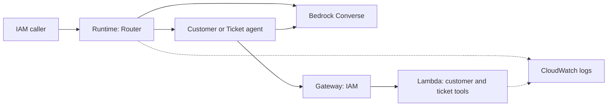

# Multi-Agent Support on Bedrock and AgentCore

A Router, Customer Agent and Ticket Agent collaborate in one Amazon Bedrock AgentCore Runtime container. Amazon Bedrock supplies inference, and an IAM-authenticated AgentCore Gateway exposes two read-only Lambda tools operating on synthetic support records. Structured logs correlate the routing and tool execution.

**Submission status: partial.** The local container and mock-based tests have been verified. AWS deployment, live inference, and cloud evidence remain pending account access. No AWS deployment or live results are claimed.



## Local verification

Python 3.12 is the container and Lambda target. Install the locked dependencies and run the offline tests:

```bash
python3.12 -m venv .venv
.venv/bin/python -m pip install --require-hashes -r requirements.lock
.venv/bin/python -m unittest discover -s tests -v
```

The six tests use model and Gateway doubles and make no AWS calls. A locally built `linux/arm64` container returned HTTP 200 and `Healthy` from `/ping`. See [local verification evidence](outputs/offline-verification.md) for details and limitations.

## AWS deployment

The candidate deployment region is `us-east-2` and the candidate model is `us.amazon.nova-micro-v1:0`. Model metadata indicates availability; actual inference and deployment access remain unverified. See the [architecture note](docs/architecture.md), [deployment guide](docs/deployment.md), [IAM design](docs/iam.md), and [evidence checklist](docs/evidence.md).

The implementation is a synthetic, single-tenant demonstration. Real AWS execution, correlated cloud logs, and production identity controls remain future work.
